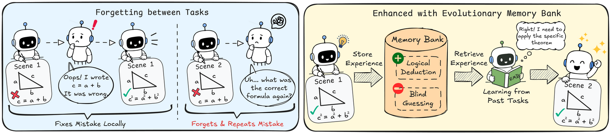
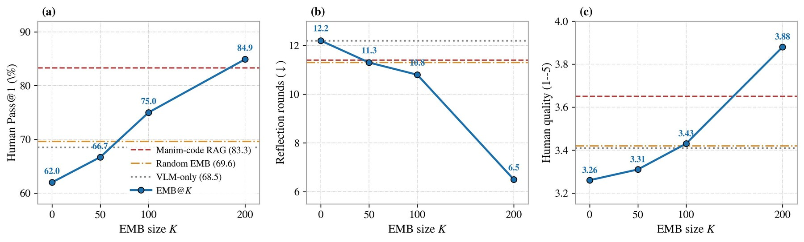
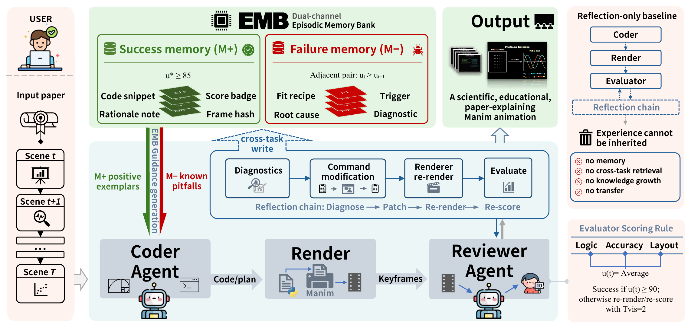

<div align="center">

<h1>🎬 ManimAgent</h1>

<h3>Self-Evolving Multimodal Agents for Visual Education</h3>

<p><b>EMNLP 2026 · Main Conference</b></p>

<p>
<a href="https://jwj1342.github.io">Wenjia Jiang</a><sup>1</sup>,
<a href="https://zongyuan-cai.github.io/">Zongyuan Cai</a><sup>2</sup>,
<a href="https://github.com/rirko">Yuanhang Shao</a><sup>2</sup>,
<a href="https://winterccc.github.io/">Chenru Wang</a><sup>3</sup>,
<a href="https://burgerio-823.github.io">Boyan Han</a><sup>2</sup>,
<a href="https://github.com/KMnO4-zx">Zhixue Song</a><sup>4</sup>,
Keyu Chen<sup>5</sup>,
<a href="https://answ.in/">Shengwei An</a><sup>3</sup>,
<a href="https://yangxuntu.github.io/">Xu Yang</a><sup>2</sup>,
<a href="https://homepage.zhouyang.me/">Zhou Yang</a><sup>1</sup>
</p>

<p>
<sup>1</sup>University of Alberta &nbsp;
<sup>2</sup>Southeast University &nbsp;
<sup>3</sup>Virginia Tech &nbsp;
<sup>4</sup>Emotion Machine Inc. &nbsp;
<sup>5</sup>Vivavia Inc.
</p>


<p>
<a href="https://2026.emnlp.org/"></a>
<a href="https://arxiv.org/abs/2606.30296"></a>
<a href="https://manimagent.github.io/"></a>
</p>

<p>
<a href="https://github.com/jwj1342/Paper2Manim/actions/workflows/ci.yml"></a>

<a href="https://www.manim.community/"></a>
<a href="https://www.langchain.com/langgraph"></a>
</p>

<p><b>English</b> · <a href="README_zh.md">中文</a></p>

<p>
<a href="#-highlights">Highlights</a> ·
<a href="#-results">Results</a> ·
<a href="#-how-it-works">How it works</a> ·
<a href="#-quick-start">Quick start</a> ·
<a href="#-citation">Citation</a>
</p>

</div>

> **TL;DR** — Reflection lets an agent recover *within* one task, but every lesson is thrown away before the next one: **cross-task forgetting**. ManimAgent carries that experience forward in a dual-channel **Episodic Memory Bank (EMB)** grown from its own task stream, with no weight updates and no human seeds.

<p align="center">
  
</p>
<p align="center"><sub><b>Left:</b> a reflection-only agent fixes a mistake locally, then repeats it on the next task. <b>Right:</b> ManimAgent stores the experience in its memory bank and gets the next scene right on the first try.</sub></p>

ManimAgent turns scientific paper sections into educational [Manim](https://www.manim.community/) animations. It plans a storyboard, generates and renders scene code, repairs execution errors, and uses a vision-language model to review visual quality. A dual-channel EMB stores successful examples and validated repair lessons for later tasks.

The Python package and command-line interface are named `paper2manim`.

## ✨ Highlights

- 🧠 **Cross-task memory, no weight updates.** A VLM reward signal and a dual-channel EMB, grown entirely from the agent's own task stream, close the gap between tasks without fine-tuning or human seeds.
- ⚖️ **Two complementary channels.** LLM distillers turn each reflection trace into a success rationale (**M+**, soft *Reference Examples*) or a structured failure lesson (**M−**, hard *Known Pitfalls*), each written only when its quality gate is met.
- 🔬 **Fixed-probe evaluation.** Frozen EMB snapshots are evaluated in read-only mode against no-memory, matched-budget RAG, and shuffled-memory baselines, with blind human scoring.

## 📊 Results

<div align="center">

| Metric | EMB@0 | Manim-code RAG | **EMB@200** |
| :--- | :---: | :---: | :---: |
| Human Pass@1 (%) ↑ | 62.0 | 83.3 | **84.9** |
| Reflection rounds ↓ | 12.2 | 11.4 | **6.5** |
| Human quality (1–5) ↑ | 3.26 | 3.65 | **3.88** |

</div>

<p align="center">
  
</p>
<p align="center"><sub>EMB@K is a frozen memory snapshot of size K. As memory grows, blind human Pass@1 and quality rise while reflection rounds fall, overtaking the static Manim-code RAG baseline at K = 200.</sub></p>

## 🧩 How it works

<p align="center">
  
</p>

1. **Storyboard:** preserve the source claim, evidence, and final takeaway in a scene plan.
2. **Generate and render:** retrieve two positive examples and three negative lessons, then produce and render Manim code.
3. **Reflect:** repair render errors and review four keyframes for logic flow, layout/occlusion, and scientific accuracy on a 0–100 scale.
4. **Consolidate:** store positive examples scoring at least 85, crash-to-success repairs, and visual repairs improving the score by at least 5 points.

The EMB uses a frozen `all-MiniLM-L6-v2` encoder and cosine retrieval through Faiss. Its positive and negative channels provide reference examples and known pitfalls to the coder. New banks start empty and accumulate experience across runs.

## 🚀 Quick start

Use Python 3.11 or 3.12. Rendering requires `ffmpeg`, Cairo/Pango, and LaTeX with `dvisvgm`; see [Getting started](docs/getting-started.md) for system dependencies.

```bash
git clone https://github.com/jwj1342/Paper2Manim.git
cd Paper2Manim
python3.11 -m venv .venv
source .venv/bin/activate
pip install -e ".[emb]"
cp config.example.yaml config.yaml
cp .env.example .env
```

Set `MANIMAGENT_API_KEY` in `.env`. The example configuration uses GPT-5.5 for all text and vision roles, following the paper. To use another model, update its name, endpoint, provider, and role bindings in `config.yaml`; the vision reviewer requires a vision-capable model.

> [!NOTE]
> Model selection requires `config.yaml`. Missing or invalid configuration raises an error; the example is never loaded automatically.

Generate an animation from local section text:

```bash
paper2manim generate --input path/to/section.txt --scene-role METHOD
```

Or select a section from an arXiv paper:

```bash
paper2manim generate --arxiv 1706.03762 --section "Background"
```

VLM review, EMB retrieval, and LLM memory distillation are enabled by default. Each scene allows up to two text retries and two visual revisions. The final video uses the highest-scoring rendered version of each scene; ties favor the earlier version. Runs are saved under `runs/<run_id>/`, and memories are stored in `runs/_emb/` by default.

## 📚 Usage and documentation

| Guide | Covers |
| :--- | :--- |
| [Getting started](docs/getting-started.md) | Installation, model configuration, inputs, outputs, and optional narration |
| [Architecture](docs/architecture.md) | Agents, scene loops, memory retrieval, and consolidation |
| [Contributing](CONTRIBUTING.md) | Development setup and tests |

```bash
paper2manim generate --help
paper2manim emb --help
```

[`examples/text/`](examples/text/) contains small text inputs. [`scripts/`](scripts/) contains environment setup, a smoke test, and a PDF batch renderer. Optional voiceover is enabled with `--voiceover` after configuring TTS.

## 📝 Citation

If you find ManimAgent useful, please cite:

```bibtex
@inproceedings{jiang2026manimagent,
  title     = {ManimAgent: Self-Evolving Multimodal Agents for Visual Education},
  author    = {Wenjia Jiang and Zongyuan Cai and Yuanhang Shao and Chenru Wang
               and Boyan Han and Zhixue Song and Keyu Chen and Shengwei An
               and Xu Yang and Zhou Yang},
  booktitle = {Proceedings of the 2026 Conference on Empirical Methods in Natural Language Processing},
  year      = {2026},
  publisher = {Association for Computational Linguistics},
  url       = {https://arxiv.org/abs/2606.30296}
}
```

<details>
<summary>arXiv version</summary>

```bibtex
@misc{jiang2026manimagentselfevolvingmultimodalagents,
  title         = {ManimAgent: Self-Evolving Multimodal Agents for Visual Education},
  author        = {Wenjia Jiang and Zongyuan Cai and Yuanhang Shao and Chenru Wang
                   and Boyan Han and Zhixue Song and Keyu Chen and Shengwei An
                   and Xu Yang and Zhou Yang},
  year          = {2026},
  eprint        = {2606.30296},
  archivePrefix = {arXiv},
  primaryClass  = {cs.AI},
  url           = {https://arxiv.org/abs/2606.30296}
}
```

</details>

## 🙏 Acknowledgements

ManimAgent builds on [Manim Community Edition](https://www.manim.community/), [LangGraph](https://www.langchain.com/langgraph), and [Marker](https://github.com/datalab-to/marker) for optional PDF parsing.
